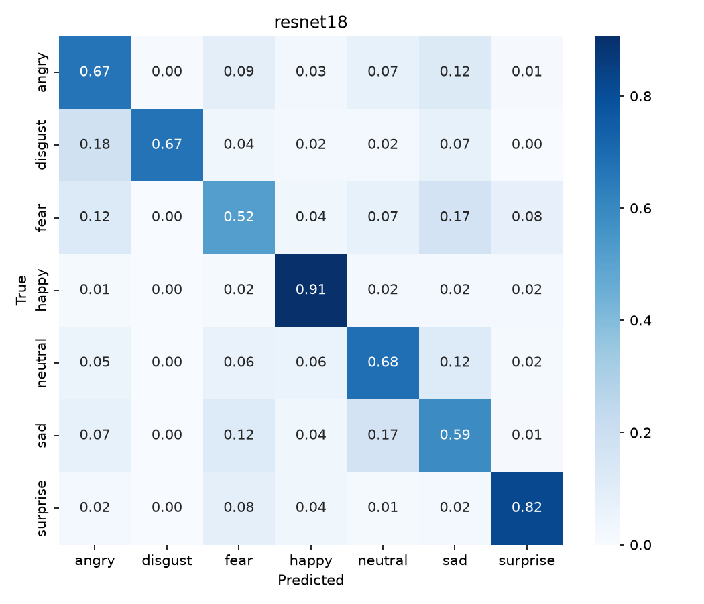
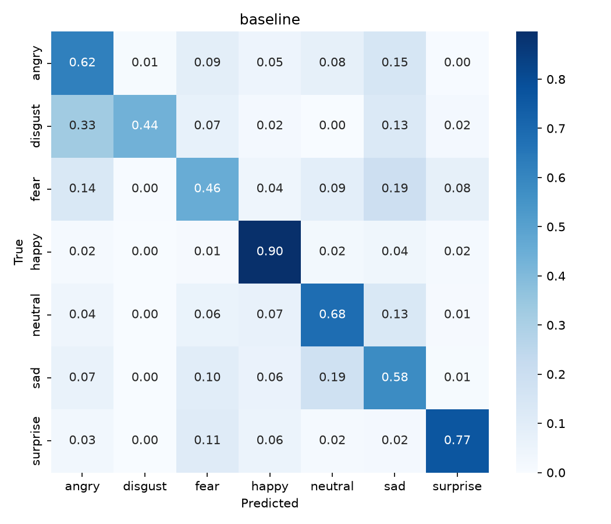

# Facial Expression Recognition on FER2013

Classifies a face image into 7 emotions (angry, disgust, fear, happy, neutral, sad, surprise) using PyTorch. Compares a baseline CNN with a ResNet-18 adapted for 48×48 images, both trained from scratch.

## Results

Evaluated on the official PrivateTest split (single run, seed 42).

| Model | Accuracy | Macro-F1 |
|---|---|---|
| Baseline CNN | 68.26% | 0.6503 |
| ResNet-18 (adapted for 48×48) | **71.16%** | **0.7042** |




## Dataset

FER2013 image-folder version from Kaggle (not included). The original splits are recovered from filename prefixes in `test/`: train = `train/` (28,709), validation = `PublicTest_*` (3,589), test = `PrivateTest_*` (3,589).

```
data/
├── train/   angry/ disgust/ fear/ happy/ neutral/ sad/ surprise/
└── test/    angry/ disgust/ fear/ happy/ neutral/ sad/ surprise/
```

## Models

- **Baseline:** 4 × (Conv → BatchNorm → ReLU → MaxPool), global pooling, dropout, linear layer
- **ResNet-18:** standard 8-block body with a 3×3 stride-1 first conv and no initial max-pool, since 48×48 inputs are too small for the ImageNet stem

Training: AdamW, cosine LR, label smoothing 0.1, augmentation (flip, rotation, crop, brightness/contrast), early stopping on validation accuracy.

## Usage

```bash
pip install torch torchvision --index-url https://download.pytorch.org/whl/cu128
pip install -r requirements.txt opencv-python

cd src
python train.py --model resnet18 --root ../data     # train
python evaluate.py resnet18                         # confusion matrix
python predict.py resnet18 /path/to/photo.jpg       # test your own image
```

## Limitations

FER2013 is small and noisy, so results vary by a point or two between runs. Performance drops on side angles, glasses and posed expressions.